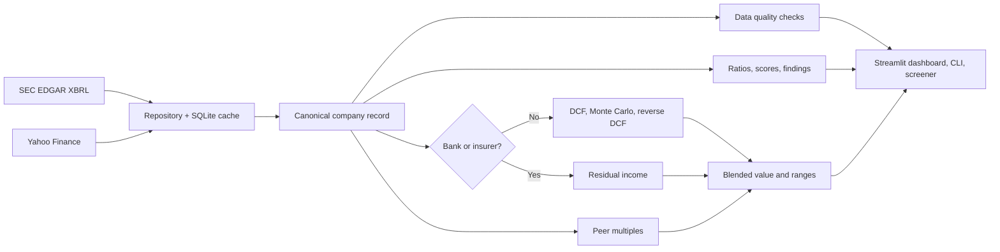

# Financial Intelligence & Valuation System

[](https://github.com/lohithaksh123/financial-valuation-system/actions/workflows/ci.yml)


[](LICENSE)

**Tech stack:** Python · pandas · NumPy · SQLite · SEC EDGAR XBRL · yfinance · Plotly · Streamlit · pytest · GitHub Actions

An end-to-end equity research tool for US and Indian companies. It ingests company financials, checks data quality, scores financial health, and values the business with several methods in an interactive dashboard.

**What it answers:** Is this company financially healthy? What is it worth under explicit assumptions? What would have to be true to justify today's price?

## Features

| Area | What it does |
|---|---|
| **Data pipeline** | Parses audited 10-K data from SEC EDGAR XBRL for US companies and Yahoo Finance statements for Indian companies into one canonical schema, with SQLite caching and a fallback path |
| **Data quality** | Scores every company on balance-sheet identity, field coverage, history length, recency and outliers |
| **Health scoring** | Piotroski F-Score, Altman Z''-Score and 14 financial ratios |
| **Analyst findings** | Rule-based flags for earnings quality, leverage, margin trends, capex surges and receivables growth |
| **DCF** | 10-year FCFF model with fading growth, CAPM-based WACC and a value-driver terminal value |
| **Monte Carlo** | 10,000 vectorized scenarios across growth, margin, WACC and terminal growth |
| **Reverse DCF** | Solves for the growth rate implied by the current share price |
| **Comparable companies** | Peer P/E, EV/EBITDA and P/B with outlier filtering and interquartile ranges |
| **Residual income** | Replaces the DCF for banks and insurers |
| **Screener** | Ranks a list of companies with one consistent methodology |
| **Your own data** | Values private companies from a manual entry grid or an uploaded CSV or Excel file, and recognizes common Indian and US line-item names |
| **Company directory** | Searchable list of every Nasdaq, NYSE and NSE company, built from the official SEC and NSE lists |
| **Editable figures** | Change any listed company's figures, price, shares or beta. Edits are saved as differences from the source and can be undone |
| **Currency display** | Shows any company in rupees or dollars at today's exchange rate |
| **Plain-language view** | Written summaries, health scorecards, tooltips for every term, and Cautious, Base and Optimistic scenarios |

## Quick start

```bash
git clone https://github.com/lohithaksh123/financial-valuation-system.git
cd financial-valuation-system
python3 -m venv .venv
source .venv/bin/activate
pip install --upgrade pip
pip install -r requirements.txt
pip install -e .
streamlit run app/streamlit_app.py
```

Set your own contact details for the SEC's fair-access policy:

```bash
export SEC_USER_AGENT="Your Name your.email@example.com"
```

Command-line use:

```bash
fivs analyze AAPL
fivs analyze "Tata Motors"
fivs screen AAPL MSFT TCS.NS --csv results.csv
```

Run the tests:

```bash
pytest
```

## Architecture



```
src/fivs/
  data/        SEC and Yahoo adapters, cache, quality checks, repository
  analysis/    ratios, Piotroski and Altman scores, findings
  valuation/   assumptions, DCF, Monte Carlo, comps, residual income, engine
  pipeline.py  end-to-end analysis shared by every interface
  cli.py       command-line interface
app/           Streamlit dashboard and charts
tests/         unit tests using offline fixtures
```

## Methodology and design decisions

**One schema for every source.** Each provider outputs the same 27 fields per fiscal year, so analysis and valuation code never depends on where data came from.

**Cleaning XBRL.** The same fact appears across filings, so the latest-filed value wins and restatements take effect. Flow items must span 340 to 380 days, which removes quarterly and cumulative figures while keeping 53-week years. Each field has a tag priority list merged by period, because companies change tags over time. Debt components are combined so overlapping tags are not double-counted.

**DCF.** Revenue growth fades linearly to the terminal rate. FCFF is NOPAT less net capex and working capital investment. Terminal value uses the value-driver formula, `NOPAT × (1 − g/RONIC) / (WACC − g)`, which ties growth to the reinvestment required to fund it. Net capex fades toward that sustainable level, so a temporary investment cycle such as an AI capex surge is not extrapolated forever.

**Cost of capital.** CAPM with a Blume-adjusted beta bounded between 0.7 and 2.0, because thinly correlated quotes can produce implausible betas. The US risk-free rate is the live 10-year Treasury yield. Market weights use equity market cap and book debt.

**One vectorized engine.** The base case, sensitivity grid and Monte Carlo all call the same NumPy function, so they cannot disagree. A test confirms that a simulation with zero uncertainty reproduces the base case exactly.

**Banks and insurers.** Deposits are raw material for a bank rather than financing, so free cash flow and enterprise value do not apply. These companies use a residual income model instead. Piotroski and Altman scores are hidden because they were designed for industrial balance sheets.

**Altman Z''.** The 1995 book-value variant is used because the original targets US manufacturers, and this tool needs one model valid for non-manufacturers and emerging markets.

**Blended value.** 60% intrinsic model and 40% peer multiples. The P/S multiple is shown but not counted, since it ignores differences in profitability.

## Known limitations

- **The defaults are conservative.** In a 15-company US sample, 9 traded more than 15% above model value, 3 more than 15% below and 3 near it. Treat the output as a statement about assumptions; use the reverse DCF and sliders to test them.
- **There is no backtest**, so nothing here demonstrates that the model predicts returns.
- **Indian data is less reliable.** Yahoo Finance is not an audited primary source and provides about four years of history. India's risk-free rate and equity risk premium are static defaults in `config.py` and should be reviewed.
- **Peer multiples are trailing twelve months** but are applied to the target's latest annual results.
- **Default peer groups are hand-curated** and fit diversified companies poorly. Reliance, for example, is a conglomerate that would be better valued sum-of-the-parts.
- **Captive finance arms** such as Ford Credit distort net debt.
- **Lease obligations** are treated inconsistently between the two data sources.
- **User-entered companies are unaudited**, and listed-peer multiples are applied without an illiquidity discount.
- **Currency conversion uses today's rate for every year.** Ratios and growth stay in the company's own terms, but historical amounts are not what they were worth at the time.

## License

MIT. See [LICENSE](LICENSE).

*Educational project, not investment advice.*
